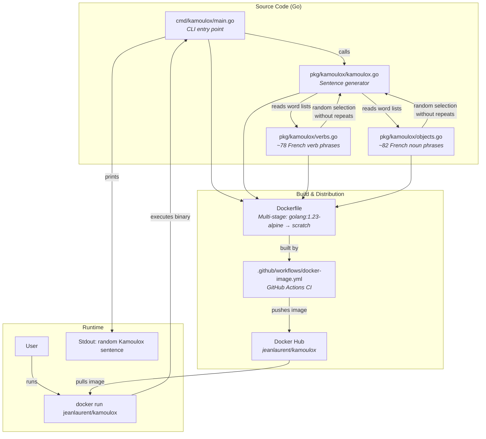

# Kamoulox — Architecture Overview

## Summary

Kamoulox is a minimal Go CLI tool that generates absurd French sentences in the style of the [Kamoulox](https://fr.wikipedia.org/wiki/Kamoulox) TV word game. It randomly pairs French verbs (e.g. "je mange", "je programme") with noun phrases (e.g. "un poulpe", "Donald Trump") to produce comical sentences like *"Je photocopie un seau et déneige un palmier."* The project is packaged as a multi-arch Docker image (`jeanlaurent/kamoulox`) built via GitHub Actions CI, producing a minimal `scratch`-based container that prints one random sentence per invocation.

## Architecture Diagram

## Key Components

| Component | Description |
|---|---|
| **`main.go`** | CLI entry point — just calls the generator and prints |
| **`kamoulox.go`** | Core logic: picks 2–4 random verb+object pairs, capitalizes correctly, joins with commas + "et" |
| **`verbs.go`** | ~78 first-person French verb phrases ("je mange", "j'invoque"…) |
| **`objects.go`** | ~82 French noun phrases & celebrity names ("un poulpe", "Donald Trump"…) |
| **`Dockerfile`** | Multi-stage: compiles in `golang:1.23-alpine`, ships in `scratch` (~2 MB final image) |
| **GitHub Actions** | Builds multi-arch (`amd64` + `arm64`), pushes to Docker Hub with SBOM + provenance attestation |

The sentence generator ensures **no word repeats** within a single sentence.
